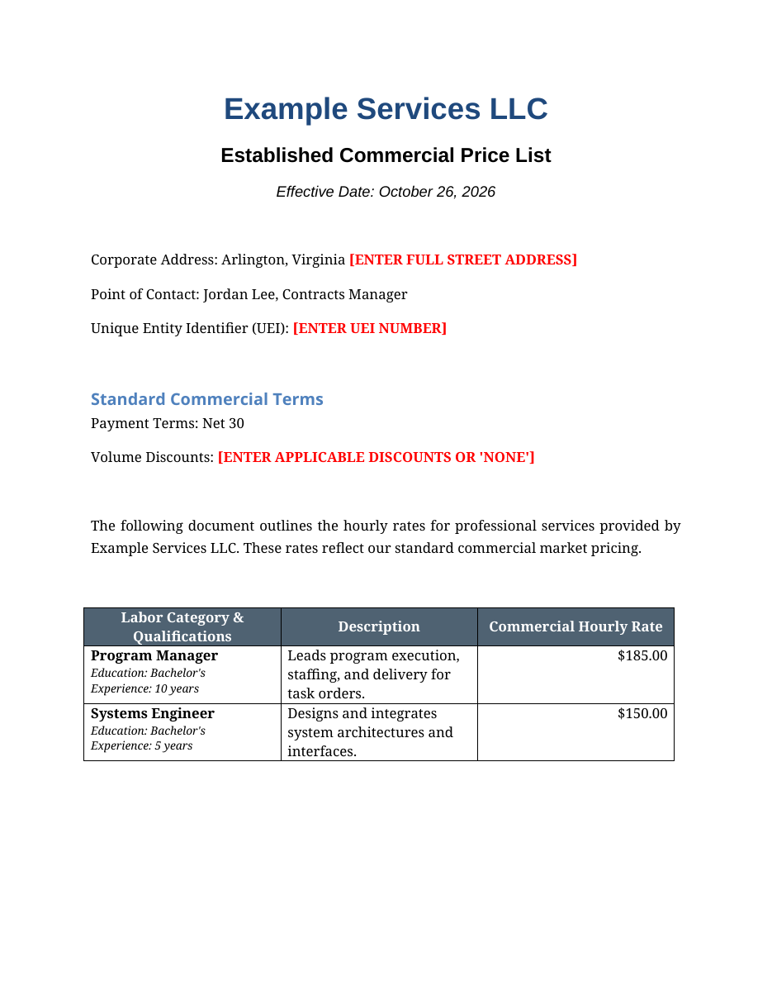
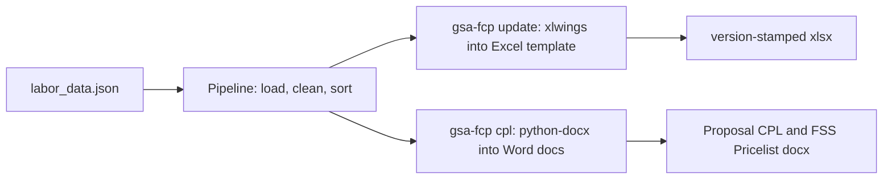

# gsa-fcp-toolkit

[](https://github.com/enonymous1/gsa-fcp-toolkit/actions/workflows/ci.yml)
[](https://www.python.org/downloads/)
[](LICENSE)

GSA Federal Supply Schedule (FSS) pricing tools for schedule holders and
pricing analysts who maintain FSS pricelists: update the FCP Excel pricelist
from labor-category JSON, and generate the Commercial Price List and
Authorized FSS Pricelist Word documents from the same data.

Refactored from an organically grown script collection (`ss-gsaFCP`) into an
installable, typed, and tested package.



*The Proposal CPL generated from `examples/sample_labor_data.json` with
sample company details — the rates table, qualifications, and red
`[BRACKETED]` placeholders.*

## Why

Maintaining a GSA Schedule pricelist by hand means editing a versioned Excel
template, recomputing IFF-inclusive rates, and retyping the same labor
categories into two Word documents — and any drift between them is a
compliance problem. `gsa-fcp-toolkit` makes one cleaned, sorted labor list
the single source of truth and regenerates all three artifacts from it, so
the Excel pricelist and both Word documents can never disagree on ordering,
sanitization, or rates.

## Non-goals

- **Does not submit or file anything with GSA.** It prepares documents;
  a human files them.
- **Does not validate rates against GSA rules or audit pricing.** It checks
  the template version and the arithmetic, not compliance.
- **Does not replace review of `[BRACKETED]` entries.** Every placeholder
  must be filled in by a person before use.
- **The Excel step is not a headless Linux Excel engine.** It drives real
  Excel via [xlwings](https://www.xlwings.org/) on Windows or macOS.

## Prerequisites

- Python 3.10+
- Excel on Windows or macOS — only for `gsa-fcp update`. `gsa-fcp cpl`
  runs anywhere, including Linux and CI.

## Install

```bash
pip install -e .
```

Contributors: `pip install -e ".[dev]"` adds the test and lint tooling.

## Quick start

```bash
# Works anywhere — generates both Word documents from the shipped sample data
gsa-fcp cpl --input examples/sample_labor_data.json
# writes ./output/Proposal_CPL.docx and ./output/Authorized_FSS_Pricelist.docx

# With your own data and template (needs Excel, Windows/macOS)
gsa-fcp update
```

Or without installing: `python -m gsa_fcp_toolkit cpl --input examples/sample_labor_data.json`

## Worked example

The sample file's Systems Engineer has no direct commercial price — both
rates are derived:

```json
{
  "title": "Systems Engineer",
  "minimum_education": "Bachelor's",
  "minimum_years_of_experience": 5,
  "price_offered_to_gsa_excluding_iff": 135,
  "discount_offered_to_gsa_off_commercial_price": "10%"
}
```

| Labor Category | Commercial | GSA (w/ IFF) |
| -------------- | ---------: | -----------: |
| Program Manager | $185.00 | $172.50 |
| Systems Engineer | $150.00 | $136.02 |

Systems Engineer math: $135.00 net / (1 − 10% discount) = $150.00
commercial, and $135.00 / (1 − 0.0075 IFF) = $136.02 GSA. The Program
Manager's rates are direct prices, used as-is.

## How it works



One pipeline feeds both commands, so the outputs share ordering and
sanitization. `update` validates the template version first, then injects
the data with formatting cloned from the template's data rows, and saves a
version-stamped file (e.g. `FCP_Services_Plus_File_PERFECT_v1.1-20260602.xlsx`).
Supported template versions are 1.1-20260128 and 1.1-20260602: a
supported-but-older template logs a warning, and anything else fails
validation with the known list. Note: the shipped template carries 4
DUMMY-EXAMPLE rows from row 4 — the run overwrites rows 4 onward but does
not clear past your data, so runs with fewer than 4 items leave the
remaining example rows in the output.

## Commands

| Command | Purpose |
| ------- | ------- |
| `gsa-fcp update [--input PATH] [--log-level LEVEL]` | Regenerate the FCP Excel pricelist |
| `gsa-fcp cpl [--input PATH] [--type proposal\|fss\|both]` | Generate the Word price lists |

Exit codes: `0` success, `1` validation or processing error, `2` missing
input file.

## Configuration

Directories and company identity are overridable via environment (copy
`.env.example` to `.env` or export them directly):

| Variable | Default |
| -------- | ------- |
| `GSA_DATA_DIR` | `./data` |
| `GSA_TEMPLATE_DIR` | `./templates` |
| `GSA_OUTPUT_DIR` | `./output` |
| `GSA_COMPANY_NAME` | `[ENTER COMPANY NAME]` |
| `GSA_COMPANY_LOCATION` | `[ENTER CITY, STATE]` |
| `GSA_COMPANY_POC` | `[ENTER POINT OF CONTACT]` |
| `GSA_PAYMENT_TERMS` | `Net 30` |

Unset company values render as red `[BRACKETED]` manual entries in the
generated Word documents — set them to brand the output. Other business
constants (IFF rate, document styling) live in `src/gsa_fcp_toolkit/config.py`.

<details>
<summary>Project layout</summary>

```
src/gsa_fcp_toolkit/
├── config.py           # paths, Excel schema, business constants, doc styling
├── logging_config.py   # single logging setup: console + rotating audit file
├── models.py           # LaborItem TypedDict
├── pipeline.py         # shared load → clean → sort
├── cli.py              # update / cpl subcommands, owns exit codes
├── data/handler.py     # pure, non-mutating DataHandler
├── excel/processor.py  # ExcelProcessor (xlwings) — the only Windows-coupled module
├── pricing/rates.py    # GSA / commercial rate math
└── word/               # styles.py + builder.py (Word document assembly)
tools/export_to_md.py   # standalone Python→Markdown documentation utility
tests/                  # pytest suite
examples/               # sample_labor_data.json (used by Quick start)
docs/                   # README screenshot
```

</details>

## Verification

- `pytest` — 46 tests covering config, data handling, rate math, logging,
  Word document generation, the shipped sample data, and the template
  version policy.
- Differential testing — the refactored data handler, rate calculators,
  Excel processor (via an `xlwings` stub), Word builder (byte-identical
  `document.xml`), and CLI (exit codes, single Excel session) were each run
  side-by-side against the original scripts with identical results.
- `ruff check`, `ruff format --check`, and `mypy --strict` are clean;
  CI runs all three plus pytest on Python 3.10–3.12.

## License

MIT — see [LICENSE](LICENSE).
